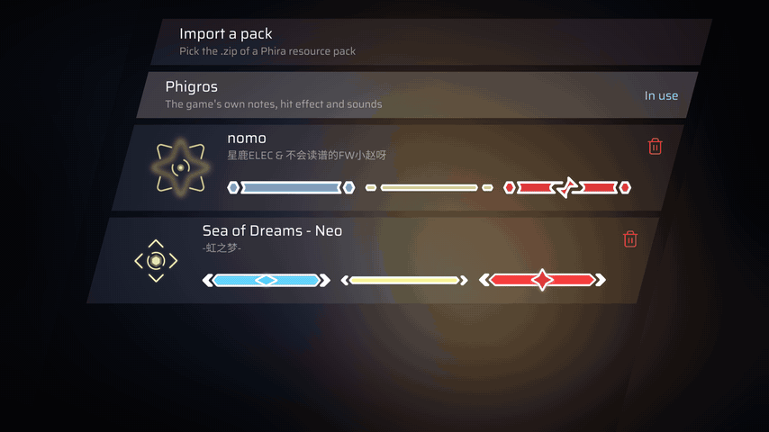
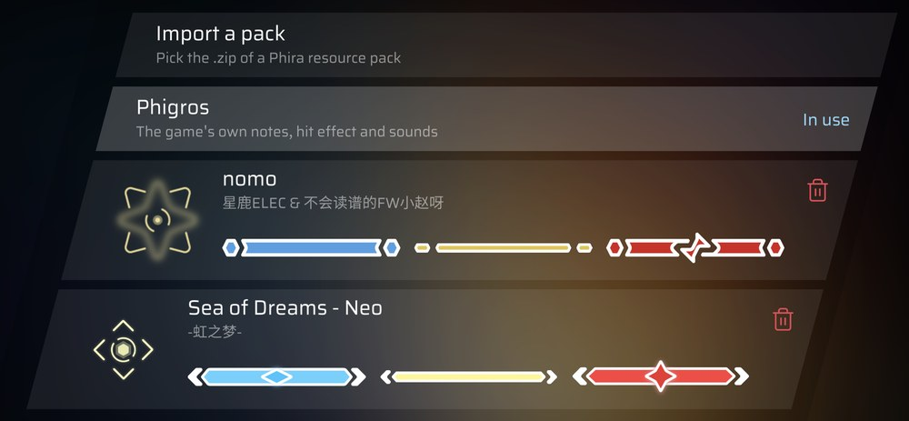
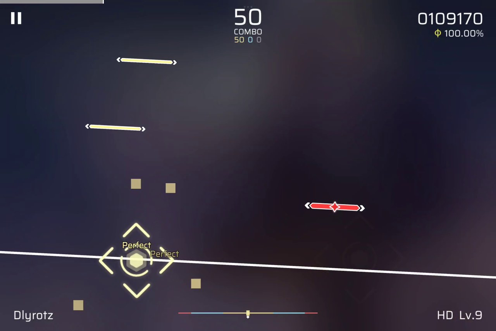

# Phira skins

A mod for [Phigros++](https://github.com/ggmolly/PhigrosPlusPlus) that plays with the resource packs made for [Phira](https://github.com/TeamFlos/phira): the notes, the hit effect and the hit sounds of a pack replace the game's, and the judge lines take its colours.

## Install

Open the **Mods** tab of the game's settings and pick Phira skins in the catalog, or open [this link](phigrospp://install/ggmolly/phigrospp-phira-skins) on the device.

## Settings

The mod adds a **Phira skins** tab to the settings, with a card per pack: a frame of its hit effect, its name, who made it, and its tap, drag and flick.

| Row | |
|---|---|
| Import a pack | Opens Android's file picker on the pack's `.zip` |
| Phigros | Goes back to the game's own notes, hit effect and sounds |
| A pack's card | A tap uses the pack, the one in use is lit. Its bin deletes it |

A pack imported again replaces the one of the same name. Packs are kept in `phigros++/phira-skins/`.

## What a pack changes

| File of the pack | |
|---|---|
| `click.png`, `drag.png`, `flick.png` | Taps, drags and flicks, as wide as the game's |
| `click_mh.png`, `drag_mh.png`, `flick_mh.png` | The same notes when hit together with another, the plain image without one |
| `hold.png`, `hold_mh.png` | The head, body and tail of holds, cut as `holdAtlas` and `holdAtlasMH` say |
| `hit_fx.png` | The hit effect: the `hitFx` grid of frames played over `hitFxDuration` seconds, `hitFxScale` times as wide as the game's effect, in `colorPerfect` and `colorGood` unless `hitFxTinted` is off |
| `click.ogg`, `drag.ogg`, `flick.ogg` | The hit sounds |

`colorPerfect` and `colorGood` are also the judge lines' colours on an all perfect and on a full combo. `hideParticles` hides the game's sparks around a hit. A file the pack doesn't have keeps the game's own.

`hitFxRotate`, `holdKeepHead`, `holdRepeat`, `holdCompact` and `ending.mp3` are left out: the game always draws effects upright and lays holds out its own way, and the mod changes how the chart looks, never where notes are.

## How it works

The pack is unpacked by Phigros++, which refuses any file leaving its folder, and only the files above are kept. Everything else is the skin API of Phigros++: `skin.note` with sprites cut from the pack's images, `skin.effect`, `skin.line` and `hitsound`. Using, importing or deleting a pack reloads the mods, so the pack in use is read once.

It needs a Phigros++ newer than 0.3.0-beta.1, for the file picker, hold skins, hit effects and hit sounds in ogg.
